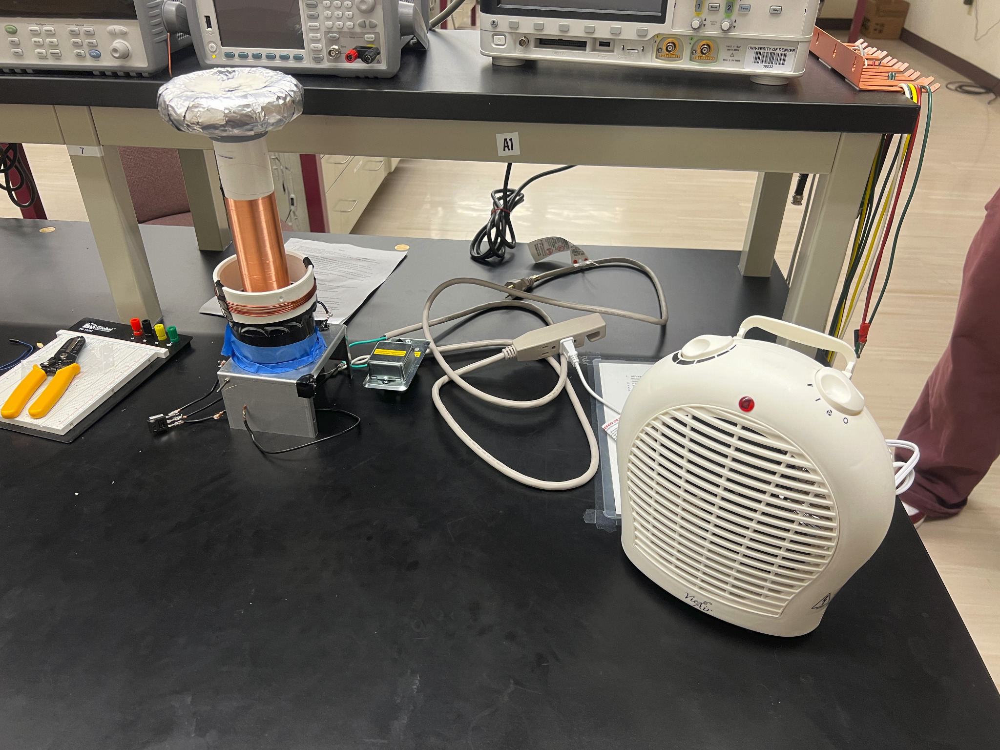
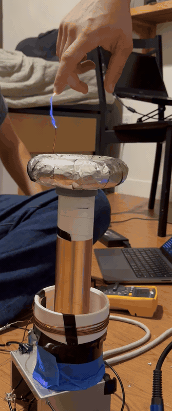
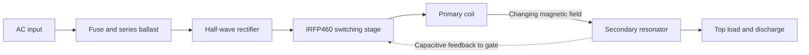

# Solid-State Tesla Coil | Electronics Final Project

**A compact, single-MOSFET Tesla coil that produced a visible high-voltage discharge.**  
*University of Denver · ENEE 2211 Electronics · Fall 2026*

**Project team:** Diego Deoliveira and Dirk Bosgraaf  
**Additional build contributor:** Owen Trafton (Mechanical Engineering)

## Project at a glance

| | |
|---|---|
| **Objective** | Design, assemble, and demonstrate an approximately one-foot-tall solid-state Tesla coil |
| **Core electronics** | IRFP460 power MOSFET, resistors, capacitors, diodes, TVS suppressors, primary and secondary coils |
| **Power approach** | Wall-powered circuit with a rectifier and a space heater used as a *series resistive ballast* |
| **Observed result** | Visible purple discharge in a recorded successful test |
| **Engineering limitation** | A separate test ended in a reported MOSFET failure; the exact cause was not established |
| **Deliverables** | Circuit block diagram, construction photograph, demonstration videos, final presentation, technical notes |

## Demonstration

- **[Watch the successful-operation recording (MP4)](assets/videos/successful-test.mp4)** — approximately 15 seconds, with a visible discharge and no MOSFET failure reported during that recording.
- **[Watch the separate failure-test recording (MP4)](assets/videos/mosfet-failure-test.mp4)** — approximately 4 seconds; the team reported MOSFET failure during this test.
- **[View the full-resolution demonstration still](assets/images/discharge-still.jpg)**

These are two **separate tests**. The recordings demonstrate operation and the limits of the prototype; they are not evidence of electrical certification or long-term reliability. The exact cause of transistor failure was not confirmed by electrical measurements.

## Motivation

The idea began in a Physics course with Professor Weber, who showed a video of a human-sized Tesla coil. That demonstration inspired Diego to research a smaller, lower-power version. Diego and Owen Trafton had discussed building one the previous year but did not complete it. The ENCE 3100 final project provided an opportunity to develop the idea with official project partner Dirk Bosgraaf and construction assistance from Owen.

## How it works (conceptual)

The power MOSFET controls rapidly changing current through the **primary coil**. Its changing magnetic field couples energy into the many-turn **secondary coil**. The secondary's inductance and capacitance, including the top load, support high-frequency resonance. A 470 pF capacitor couples a signal from the secondary back to the MOSFET gate, helping sustain oscillations. The output can reach a high enough electric field to produce a visible discharge.

The circuit uses additional resistors for gate bias, TVS diodes to suppress some switching transients, a 100 nF supply-bypass capacitor, a fuse for certain overcurrent conditions, and a **space heater as a resistive ballast** to limit available input current.

**[Read the technical overview and component reference](docs/circuit-overview.md)**  
**[View the team-supplied circuit diagram](assets/images/circuit-diagram.png)**

> **Safety and scope:** This is an educational record of an experimental, mains-powered high-voltage prototype, **not** a build guide, independently verified schematic, or safety-certified device. A ballast, fuse, and TVS diodes do not make exposed mains connections safe. Do not recreate or energize this assembly from the images or diagram. Any further work would require a qualified laboratory safety/design review and properly engineered protective measures.

## Engineering challenges and lessons

The hardest tasks were winding the coils—especially the tightly wound secondary—making reliable solder connections to copper wire, maintaining correct primary connections, and keeping hand-soldered joints intact during assembly and testing. The MOSFET failure also raised practical questions about transient voltage, thermal stress, device ratings, and switching behavior. Those explanations are **possible mechanisms, not a verified diagnosis**.

This project provided hands-on experience with:

- Power MOSFET switching, gate bias, and high-frequency feedback.
- Electromagnetic induction and resonant energy transfer.
- Point-to-point circuit assembly, copper winding, and solder-joint reliability.
- Evaluating protective components while recognizing their limitations.
- Documenting both functional results and unresolved failure modes.

See **[construction challenges](docs/construction-challenges.md)** and **[testing results and limitations](docs/testing-results.md)**.

## Media and project files

| Artifact | Contents |
|---|---|
| [Circuit block diagram](assets/images/circuit-diagram.png) | Team-supplied component connections and values (not independently checked) |
| [Completed lab setup](assets/images/full-lab-setup.jpg) | The assembled coil, fuse area, cabling, and ballast heater |
| [Circuit assembly photo](assets/images/circuit-assembly.png) | Hand-soldered electronics inside the metal enclosure |
| [Successful test video](assets/videos/successful-test.mp4) | Recorded high-voltage operation |
| [MOSFET failure test video](assets/videos/mosfet-failure-test.mp4) | Separate recorded test associated with the reported failure |
| [Editable final presentation](presentation/ENCE3100-Solid-State-Tesla-Coil.pptx) | Ten-slide ENCE 3100 final presentation (earlier failure-test clip embedded) |
| [Technical documentation](docs/circuit-overview.md) | Operating principles, block diagram, and component roles |
| [Results and limitations](docs/testing-results.md) | Observations vs. unverified hypotheses |

## Outcome and next steps

The project met its central demonstration objective: a small solid-state Tesla coil produced a visible discharge. It was **not** characterized as a reliable or continuously operable device. A logical next phase would begin with a qualified safety review, followed by instrumented electrical and thermal characterization under appropriate laboratory controls. No frequency, voltage, current, output power, or efficiency numbers are claimed without measurements.

**Project credits:** ENEE 2211 course project, University of Denver. Diego Deoliveira and Dirk Bosgraaf were the official project partners; Owen Trafton contributed additional mechanical/build assistance. The project began with inspiration from Professor Webber's Physics demonstration.

