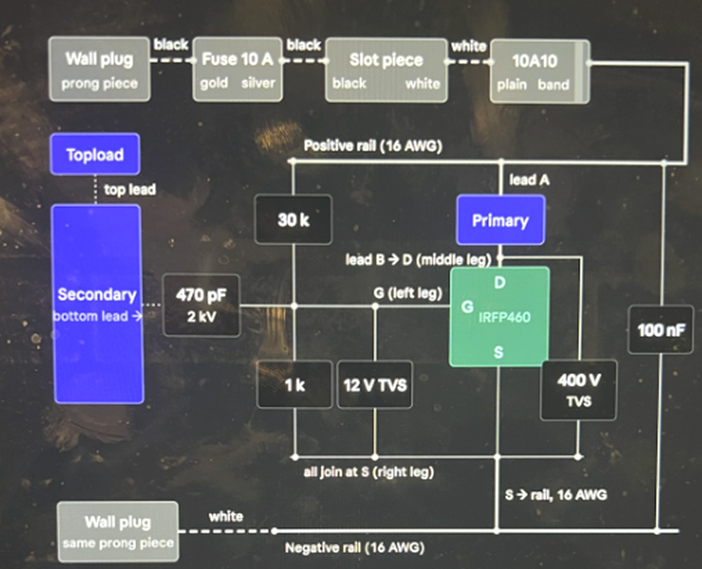

# Circuit overview and electronics principles

> **Scope:** Conceptual description only. The following information was drawn from the team's block diagram, photos, and discussion. The drawn circuit is **not** an independently validated schematic, a safe wiring plan, or a set of operating instructions. The experiment involved mains voltage and a high-voltage resonator.

## Original project diagram

## Functional explanation

The circuit is a single-MOSFET, feedback-driven solid-state Tesla coil. Its **IRFP460 N-channel MOSFET** switches primary-winding current. A changing primary current creates a changing magnetic field, which magnetically couples energy to the **secondary winding**. The many-turn secondary winding and its capacitance, including the conductive top load, form a resonant system that can develop a large high-frequency output voltage.

The secondary's bottom connection is shown feeding the MOSFET gate through a **470 pF capacitor**. This is **feedback**: a portion of the resonator's electrical signal returns to influence the timing of the electronic switch, helping the system oscillate.

The secondary resonant frequency is approximately described by `f₀ = 1 / (2π√(LC))`, where `L` is the secondary's effective inductance and `C` its effective capacitance. **L and C were not measured**, so the actual resonant frequency is unknown.

## Components and roles

| Part labeled in diagram | Intended function |
|---|---|
| Primary winding | Converts changing switched current into a changing magnetic field |
| Secondary winding | Many-turn winding that receives magnetically coupled energy and participates in resonance |
| Conductive top load | Adds capacitance and influences the resonant frequency and electric-field distribution |
| IRFP460 MOSFET | Switches current in the primary circuit |
| 470 pF, 2 kV capacitor | Couples secondary feedback into the MOSFET gate network; the diagram's rating is *not* a verified measured circuit voltage |
| 30 kΩ resistor | Provides a gate-bias path that helps startup |
| 1 kΩ resistor | Provides a gate-to-source path to help control the gate potential |
| 12 V TVS diode | Intended to suppress gate-to-source transients |
| 400 V TVS diode | Intended to suppress drain-to-source transients; the indicated value is **not** a guaranteed fixed clamping voltage |
| 100 nF capacitor | Provides high-frequency bypassing/decoupling across the supply rails |
| 10A10 diode | Provides half-wave rectification of the AC input into pulsating DC |
| 10 A fuse | Intended to interrupt certain excessive-current faults; does not eliminate electric-shock hazards or protect against every MOSFET failure |
| Space heater used as ballast | A series resistive load that limits available current; **not** a validated safety device |

## Key definitions

**Half-wave rectification.** A rectifier diode conducts in one direction, so only one half of each AC cycle is delivered to the load. The result is **pulsating DC**, not a tightly regulated DC rail.

**Changing magnetic field.** Rapid changes in the primary's current change the magnetic flux through the secondary, inducing voltage through electromagnetic induction (Faraday's law).

**Resonance.** The secondary's inductive and capacitive properties allow energy to oscillate at a preferred frequency, producing a strong voltage response when driven appropriately.

**Feedback.** A signal derived from the secondary resonator returns through a coupling capacitor to the MOSFET gate to influence switching.

**Bias.** Resistor paths influence the gate's initial and operating voltage conditions.

**Transient suppression.** TVS diodes are intended to conduct strongly during brief overvoltage events. They do not guarantee survival during every overvoltage, overcurrent, or overheating event.

**Decoupling.** The 100 nF supply capacitor presents a relatively low impedance at high frequencies to reduce rapid rail disturbances; it does **not** smooth the half-wave power waveform into constant DC.

## Data not obtained

We do not have scope captures, calibrated output-voltage measurements, primary-current waveforms, MOSFET temperature records, resonant-frequency measurements, or efficiency data. The diagram alone does not establish these values or the actual stress seen by the MOSFET.

## Safety

This prototype used wall power, hand-assembled high-voltage hardware, and an exposed resonator. Some photos show accessible wires and conductors. **Do not treat the diagram as a construction or testing reference.** Before any further experiments, a qualified instructor or lab engineer would need to review input isolation, mechanical enclosure, insulation, protective earth/grounding, guarding, safe discharge procedures, and measurement methods.
